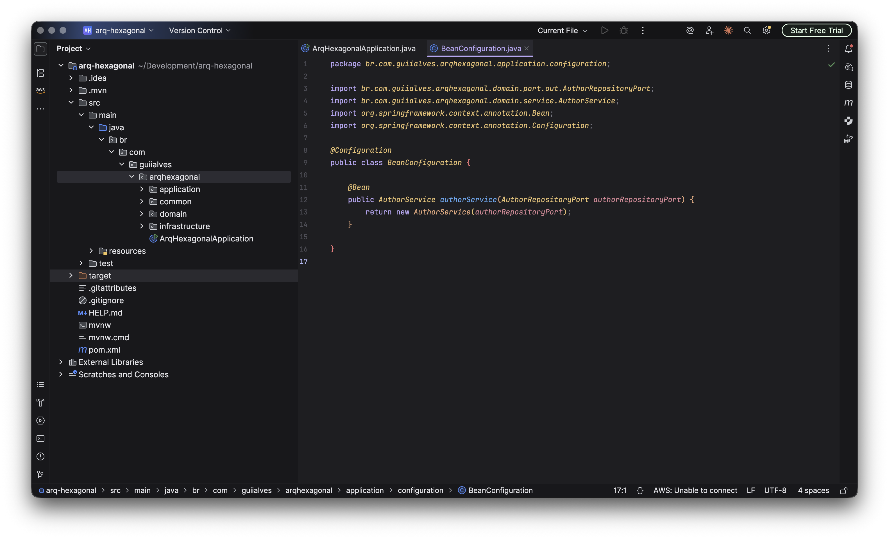
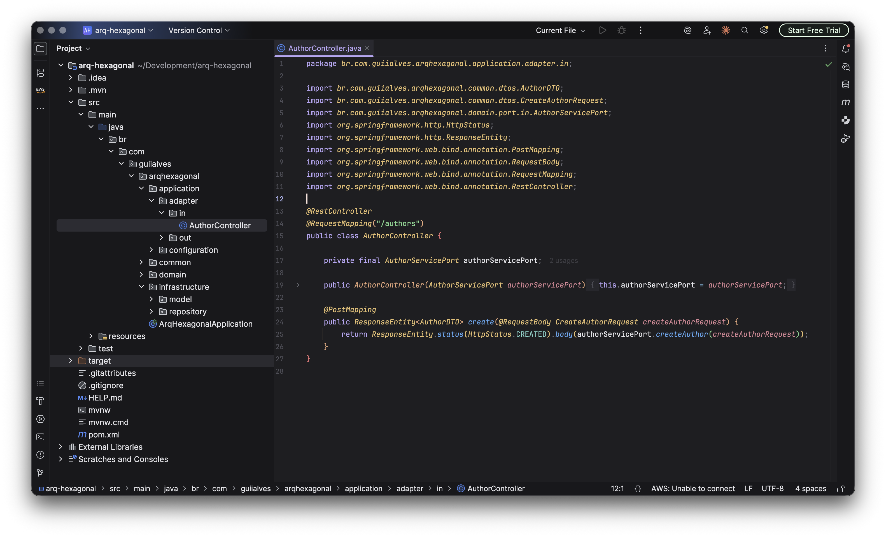

# Elipse — temas para IntelliJ

Família de temas escuros minimalistas para IntelliJ (UI inteira: painéis,
botões, abas, menus + cores do editor/código), construída a partir do esquema
oficial do [Catppuccin Mocha para JetBrains](https://github.com/catppuccin/jetbrains)
(mesma base usada pelo plugin com +2M de downloads), recolorida para um visual
mais minimalista estilo Vercel (fundo neutro em cinza, sem o tom azulado do
Catppuccin original), com poucos acentos pastel bem marcados.

Duas variantes, no mesmo plugin — instala uma vez, escolhe no dropdown:

- **Elipse** — a original. "Elipse" é a figura de linguagem de omitir o óbvio
  pra dizer mais com menos (e também o nome da forma geométrica oval).
- **Lítote** — variante mais escura, acentos um pouco mais saturados/frios.
  "Lítote" é a figura retórica de afirmar algo atenuando — dizer menos pra
  comunicar mais. Duas figuras de contenção, uma dupla coerente.

v2: paleta de fundo um pouco mais escura, hover e seleção da sidebar com mais
contraste entre si (pra não parecerem um bloco só quando ficam lado a lado).

v2.1: linha do cursor (`CARET_ROW_COLOR`) estava com a mesma cor do fundo —
corrigido. Breadcrumbs (`pacote > classe > método` abaixo das abas) agora usam
o roxo de destaque no item atual/hover, e um cinza mais apagado no que não é
o escopo ativo, em vez de tudo na mesma cor.

v2.2: adicionada a variante **Lítote**, empacotada junto no mesmo plugin.

## Screenshots




## Instalar (recomendado: plugin com UI + editor, as duas variantes juntas)

1. Abra o IntelliJ → `Settings/Preferences` → `Plugins`.
2. Clique na engrenagem ⚙️ no topo da lista → `Install Plugin from Disk...`.
3. Selecione o arquivo `elipse.jar` desta pasta.
4. Reinicie o IntelliJ quando ele pedir.
5. Vá em `Settings` → `Appearance & Behavior` → `Appearance` → dropdown `Theme`
   → escolha **"Elipse"** ou **"Lítote"**.
6. Confira também `Settings` → `Editor` → `Color Scheme`: esse dropdown é
   **separado** do Theme e não troca sozinho — selecione o mesmo nome ali também.

Se você já tinha instalado uma versão antiga (`breve` / `Minimal Cappuccino`),
desinstale-a primeiro (`Plugins` → busque o nome → `Uninstall`), já que o id
interno muda a cada renomeação.

### Se "Synced with OS" estiver travando alguma coisa

Em `Settings` → `Editor` → `Color Scheme`, se o dropdown não deixar trocar,
clique em `Configure...` ao lado de "Synced with OS" e desative a sincronização
automática com o tema do sistema.

## Alternativa: só as cores do editor (sem mexer na UI)

Se preferir manter a UI padrão (Darcula) e só trocar a sintaxe do código:

1. `Settings` → `Editor` → `Color Scheme` → engrenagem ⚙️ → `Import Scheme...`
   → `IntelliJ IDEA color scheme (.icls)` → selecione `elipse.icls` ou `litote.icls`.
2. Se o diálogo não aceitar o arquivo, copie-o manualmente para a pasta de
   esquemas do IDE e reinicie:
   ```
   ~/Library/Application Support/JetBrains/<Produto+Versão>/colors/
   ```
   Exemplo: `~/Library/Application Support/JetBrains/IntelliJIdea2025.3/colors/`
   (já deixei cópias de ambos lá pra você).

## Paleta usada

| Papel | Elipse | Lítote |
|---|---|---|
| Fundo (background) | `#1e1e21` | `#1a1a1d` |
| Painéis / mantle | `#18181b` | `#141416` |
| Toolbar / crust | `#141416` | `#0f0f11` |
| Hover (sidebar) | `#212124` | `#1d1d20` |
| Seleção (sidebar) | `#2c2c33` | `#282830` |
| Texto padrão | `#e6e6ea` | `#e2e2e6` |
| Palavras-chave | `#b9a6f5` | `#a78bfa` |
| Funções / métodos | `#5ea8f2` | `#60a5fa` |
| Strings | `#7fd88f` | `#6ee7a0` |
| Números / constantes | `#e8a87c` | `#e3936a` |
| Avisos / accent secundário | `#e8c170` | `#e0b35c` |
| Erros | `#f2777a` | `#ef6f71` |

## Como ajustar

- **UI** (botões, painéis, abas): edite `elipse.theme.json` / `litote.theme.json`.
  A maior parte das chaves em `"ui"` referencia nomes simbólicos definidos em
  `"colors"` (ex.: `"accentColor"`, `"panelBackground"`) — mude ali que o resto
  segue junto.
- **Editor/código**: edite `elipse.icls` / `litote.icls` (XML). Tem
  `parent_scheme="Darcula"`, ou seja, qualquer atributo não sobrescrito cai de
  volta no Darcula padrão — por isso não existe risco de elemento "sem cor".
- Depois de editar, reempacote em `.jar` (é só um zip de `META-INF/plugin.xml` +
  `themes/*.json` + `themes/*.xml` — o jar carrega os dois conjuntos de arquivos
  ao mesmo tempo, `themes/elipse.*` e `themes/litote.*`) ou peça pra eu regenerar.

## Arquivos nesta pasta

| Arquivo | Para quê |
|---|---|
| `elipse.jar` | Plugin completo — Elipse **e** Lítote juntos (UI + editor) — instalar via "Install Plugin from Disk" |
| `elipse.icls` / `litote.icls` | Só o esquema do editor de cada variante — instalar via "Import Scheme" |
| `elipse.theme.json` / `litote.theme.json` | Fonte do tema de UI de cada variante, editável (também embutidos no jar) |
| `_referencia-catppuccin-mocha.xml` / `_referencia-catppuccin-macchiato.xml` | Catppuccin original, sem alterações — só referência/comparação |
